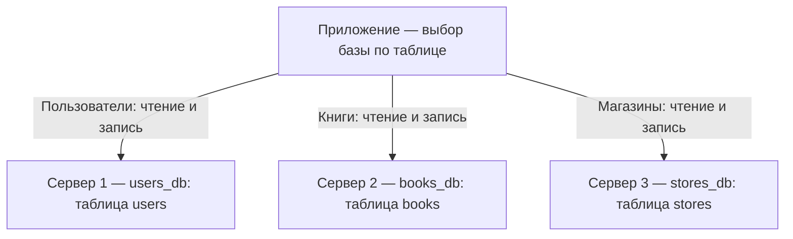
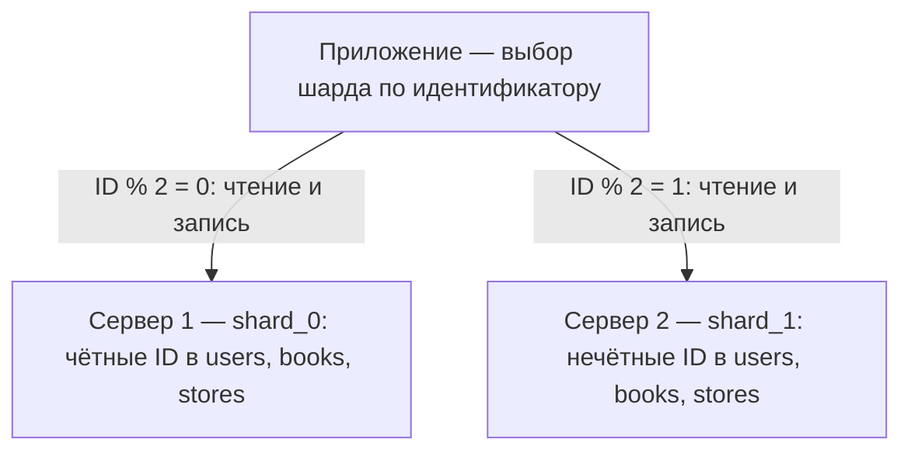

# Домашнее задание к занятию «Репликация и масштабирование. Часть 2» — Сергеев Александр

## Задание 1

### Активный master-сервер и пассивный slave-сервер

Master обслуживает запросы приложения на чтение и запись.
Slave получает изменения с master и хранит копию данных.
В штатном режиме пассивный slave не обслуживает запросы приложения.

Преимущества:

- Наличие подготовленного резервного сервера для восстановления работы при отказе master.
- Возможность планового переключения на резервный сервер при обслуживании основного.
- Возможность выполнять резервное копирование на slave, снижая нагрузку на master.

Основное преимущество схемы — повышение доступности.
Пропускная способность приложения напрямую не увеличивается,
поскольку запросы обрабатывает один активный сервер.

При асинхронной репликации slave может отставать.
Переключение на него требует проверки состояния реплики
и исключения одновременной записи на старый и новый master.

### Master-сервер и несколько slave-серверов

Master обрабатывает запись, а slave-серверы могут обслуживать чтение.
Запросы распределяются приложением или прокси.

Преимущества:

- Распределение нагрузки на чтение между несколькими серверами.
- Снижение нагрузки на master.
- Возможность добавлять реплики при увеличении количества запросов.
- Возможность выделить отдельные реплики для отчётности и резервного копирования.
- Возможность продолжать чтение с других реплик при отказе одной из них.

Масштабируется прежде всего чтение: запись остаётся на master.
Из-за задержки репликации запросы, которым необходимы актуальные
данные сразу после записи, направляются на master.

## Задание 2

### Исходные таблицы

| Таблица | Пример столбцов |
|---|---|
| users — пользователи | user_id, name, email |
| books — книги | book_id, title, author, price |
| stores — магазины | store_id, name, city, address |

Ниже представлены два самостоятельных варианта разделения базы данных.

### Вертикальное разделение по таблицам

В этом варианте данные распределяются по назначению:
каждая таблица переносится в отдельную базу на отдельном сервере.
Точнее такой подход называется функциональным разделением.

| Сервер | База данных | Содержимое |
|---|---|---|
| Сервер 1 | users_db | Вся таблица users |
| Сервер 2 | books_db | Вся таблица books |
| Сервер 3 | stores_db | Вся таблица stores |

Принципы работы:

- Запросы к пользователям направляются в `users_db`,
  к книгам — в `books_db`, к магазинам — в `stores_db`.
- Каждый сервер работает активно и принимает чтение и запись
  для своей таблицы.
- Ресурсы серверов можно увеличивать независимо.
  Например, сервер книг можно усилить при росте нагрузки на каталог.
- Если запросу нужны данные из нескольких баз,
  приложение получает их отдельно и объединяет результат.
- Согласованность операций между независимыми серверами
  должна обеспечиваться отдельно на уровне приложения.

План перехода:

1. Подготовить три сервера и создать целевые базы.
2. Перенести каждую таблицу в соответствующую базу.
3. На время окончательной синхронизации приостановить запись.
4. Проверить количество строк и содержимое перенесённых данных.
5. Настроить маршрутизацию запросов приложения и возобновить запись.

### Горизонтальное разделение

Все три таблицы сохраняются в каждой базе.
Между серверами распределяются строки этих таблиц.

Для учебного примера используются два шарда:

| Таблица | Шард 0 | Шард 1 |
|---|---|---|
| users | user_id % 2 = 0 | user_id % 2 = 1 |
| books | book_id % 2 = 0 | book_id % 2 = 1 |
| stores | store_id % 2 = 0 | store_id % 2 = 1 |

Например, пользователь с `user_id = 10` хранится в шарде 0,
а пользователь с `user_id = 11` — в шарде 1.

Принципы работы:

- Структура таблиц в обоих шардах одинакова, содержимое различается.
- Приложение определяет шард по идентификатору записи.
- Оба сервера работают активно: принимают чтение и запись
  для принадлежащих им строк.
- Идентификаторы выдаются централизованно до выбора шарда,
  чтобы исключить совпадения между серверами.
- Запрос по известному идентификатору направляется в один шард.
- Общий поиск и отчётность обращаются к обоим шардам,
  после чего приложение объединяет результаты.
- При появлении связей между таблицами нужно учитывать,
  что связанные записи могут находиться на разных серверах.
- При добавлении шардов правило распределения потребуется изменить
  и перенести часть данных. Для дальнейшего расширения можно
  использовать таблицу соответствия записей и шардов.

План перехода:

1. Подготовить два сервера с одинаковой структурой таблиц.
2. Настроить выдачу уникальных идентификаторов и выбор шарда.
3. Распределить существующие строки по остаточному делению ID на 2.
4. На время окончательной синхронизации приостановить запись.
5. Проверить отсутствие пропущенных и дублирующихся строк.
6. Переключить приложение на работу с шардами и возобновить запись.

### Режимы работы серверов

В обоих вариантах каждый основной сервер принимает чтение и запись
только для своей части данных. Это разные наборы данных,
поэтому серверы не являются репликами друг друга.

При необходимости резервирования к каждому основному серверу
добавляется пассивный slave с копией именно его данных.
Репликация обеспечивает резервирование, а разделение данных
распределяет хранение и нагрузку между основными серверами.