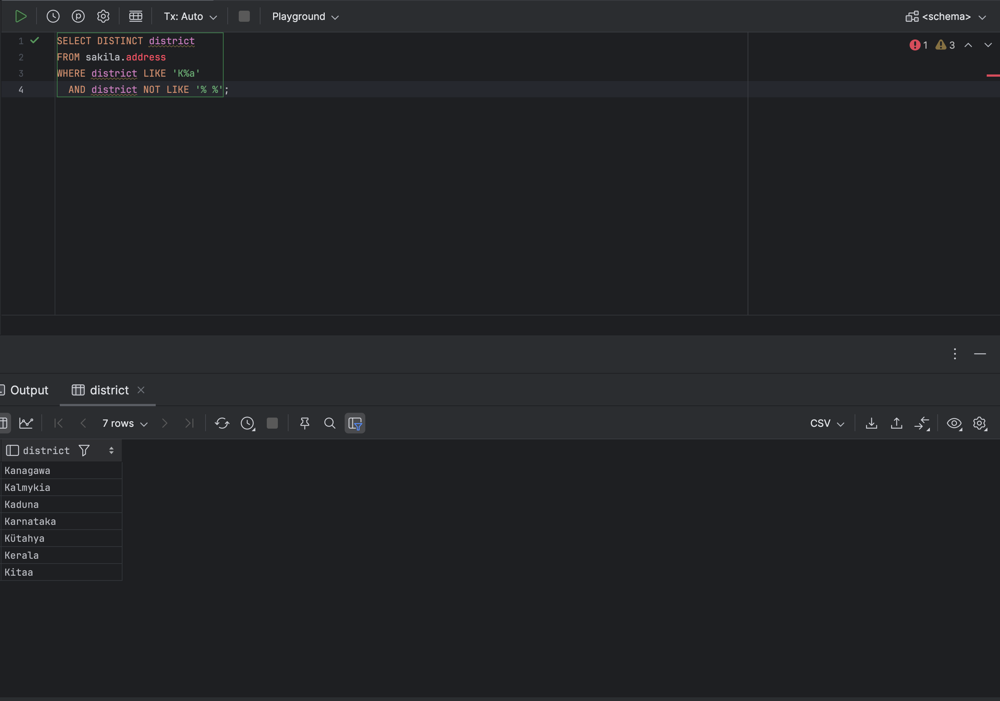
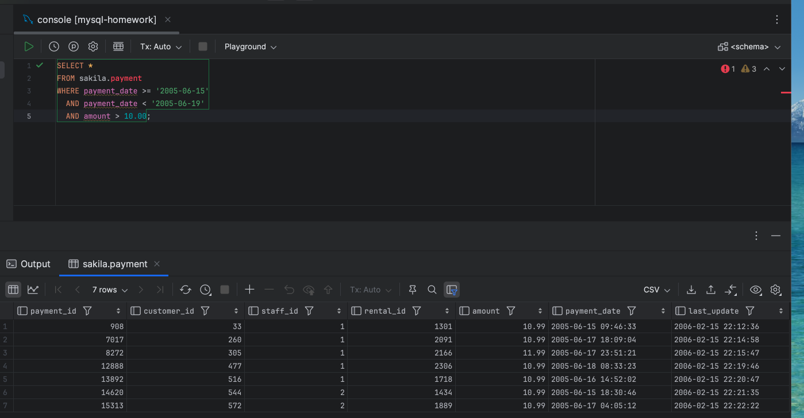
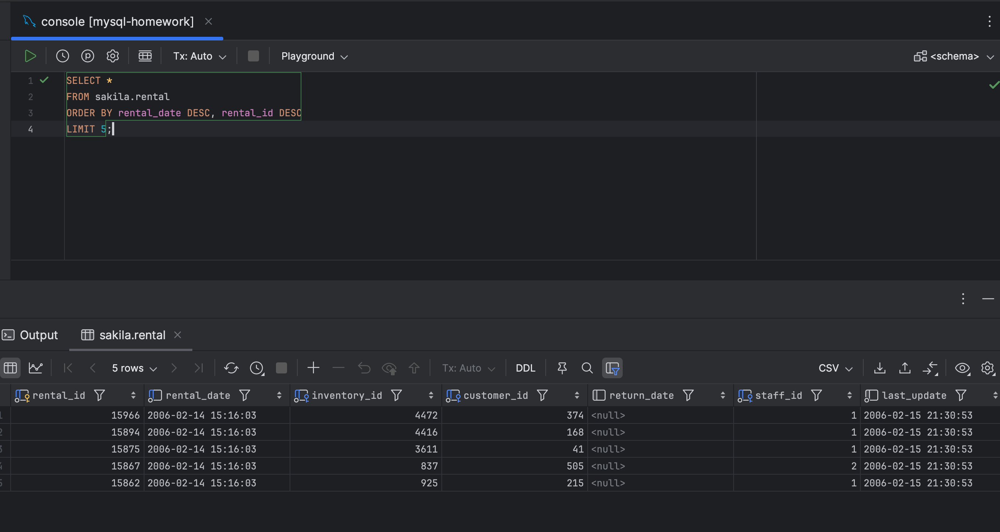
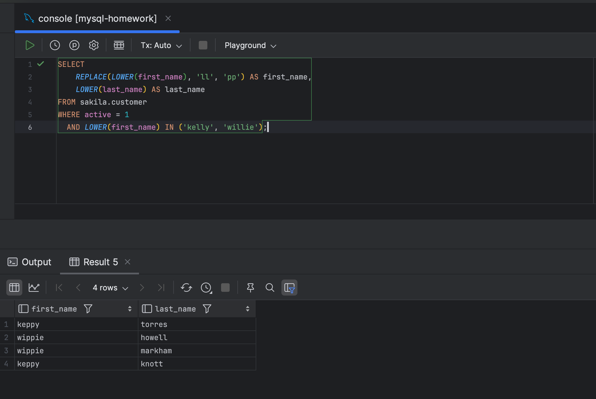

# Домашнее задание к занятию «Операции с данными в SQL» — Сергеев Александр

# Домашнее задание к занятию «SQL. Часть 1» — Сергеев Александр

## Задание 1

Получены уникальные названия районов, которые начинаются на `K`, заканчиваются на `a` и не содержат пробелов.

```sql
SELECT DISTINCT district
FROM sakila.address
WHERE district LIKE 'K%a'
  AND district NOT LIKE '% %';
```

Для исключения повторяющихся значений используется `DISTINCT`.
Условие `LIKE 'K%a'` проверяет начало и конец названия.
Условие `NOT LIKE '% %'` исключает названия с пробелами.

В результате получено 7 районов.



## Задание 2

Получены платежи за прокат фильмов, выполненные с 15 по 18 июня 2005 года включительно, на сумму больше `10.00`.

```sql
SELECT *
FROM sakila.payment
WHERE payment_date >= '2005-06-15'
  AND payment_date < '2005-06-19'
  AND amount > 10.00;
```

Верхняя граница указана как начало следующего дня, чтобы включить все платежи за 18 июня независимо от времени.



## Задание 3

Получены последние пять аренд фильмов.

```sql
SELECT *
FROM sakila.rental
ORDER BY rental_date DESC, rental_id DESC
LIMIT 5;
```

Аренды отсортированы по дате от новых к старым.
При совпадении даты и времени используется сортировка по идентификатору аренды.
Оператор `LIMIT 5` ограничивает результат пятью записями.



## Задание 4

Одним запросом получены активные покупатели с именами Kelly или Willie.
Имя и фамилия переведены в нижний регистр, сочетание `ll` в именах заменено на `pp`.

```sql
SELECT
    REPLACE(LOWER(first_name), 'll', 'pp') AS first_name,
    LOWER(last_name) AS last_name
FROM sakila.customer
WHERE active = 1
  AND LOWER(first_name) IN ('kelly', 'willie');
```

Условие `active = 1` выбирает активных покупателей.
Функция `LOWER()` переводит буквы в нижний регистр.
Функция `REPLACE()` заменяет `ll` на `pp` в именах.

