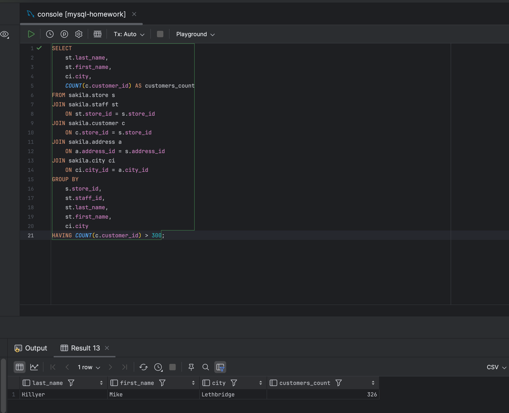
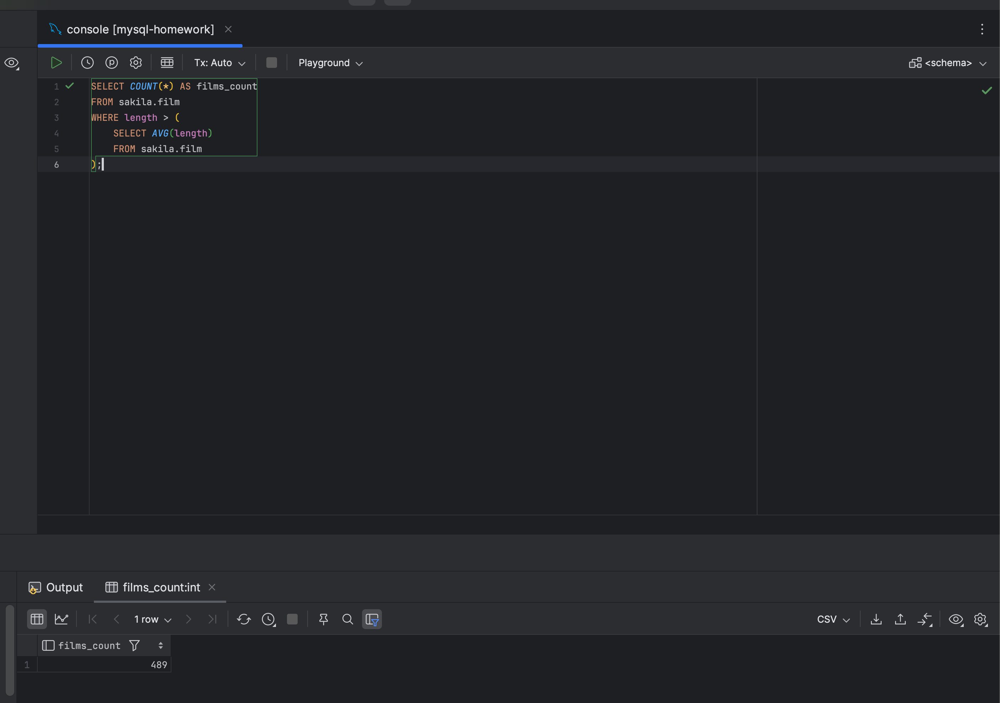
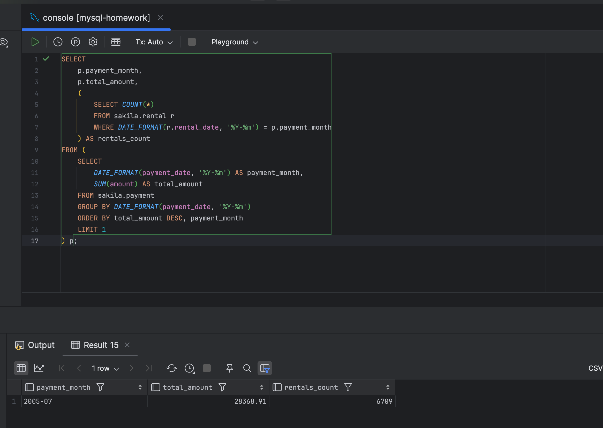

# Домашнее задание к занятию «Расширенные возможности SQL» — Сергеев Александр

## Задание 1

Одним запросом получены фамилия и имя сотрудника, город магазина
и количество закреплённых покупателей для магазинов,
в которых обслуживается более 300 покупателей.

```sql
SELECT
    st.last_name,
    st.first_name,
    ci.city,
    COUNT(c.customer_id) AS customers_count
FROM sakila.store s
JOIN sakila.staff st
    ON st.store_id = s.store_id
JOIN sakila.customer c
    ON c.store_id = s.store_id
JOIN sakila.address a
    ON a.address_id = s.address_id
JOIN sakila.city ci
    ON ci.city_id = a.city_id
GROUP BY
    s.store_id,
    st.staff_id,
    st.last_name,
    st.first_name,
    ci.city
HAVING COUNT(c.customer_id) > 300;
```

Таблицы соединены по идентификаторам магазина, адреса и города.
Город определён по адресу магазина.

Количество покупателей рассчитано функцией `COUNT()`.
Условие `HAVING` оставляет группы, в которых покупателей больше 300.



## Задание 2

Получено количество фильмов, продолжительность которых больше
средней продолжительности всех фильмов.

```sql
SELECT COUNT(*) AS films_count
FROM sakila.film
WHERE length > (
    SELECT AVG(length)
    FROM sakila.film
);
```

Подзапрос с `AVG(length)` вычисляет среднюю продолжительность
всех фильмов. Условие `WHERE` отбирает фильмы с продолжительностью
выше средней, а `COUNT(*)` подсчитывает их количество.



## Задание 3

Определён месяц с наибольшей суммой платежей.
Дополнительно получено количество аренд за этот календарный месяц.

```sql
SELECT
    p.payment_month,
    p.total_amount,
    (
        SELECT COUNT(*)
        FROM sakila.rental r
        WHERE DATE_FORMAT(r.rental_date, '%Y-%m') = p.payment_month
    ) AS rentals_count
FROM (
    SELECT
        DATE_FORMAT(payment_date, '%Y-%m') AS payment_month,
        SUM(amount) AS total_amount
    FROM sakila.payment
    GROUP BY DATE_FORMAT(payment_date, '%Y-%m')
    ORDER BY total_amount DESC, payment_month
    LIMIT 1
) p;
```

Платежи сгруппированы по году и месяцу выполнения.
Сумма рассчитана функцией `SUM(amount)`.
Сортировка по убыванию суммы и `LIMIT 1` позволяют выбрать
месяц с максимальной суммой платежей.

Количество аренд рассчитано отдельным подзапросом по `rental_date`
за тот же год и месяц.

Наибольшая сумма платежей получена в июле 2005 года — 28 368,91.
Количество аренд за этот месяц — 6709.

