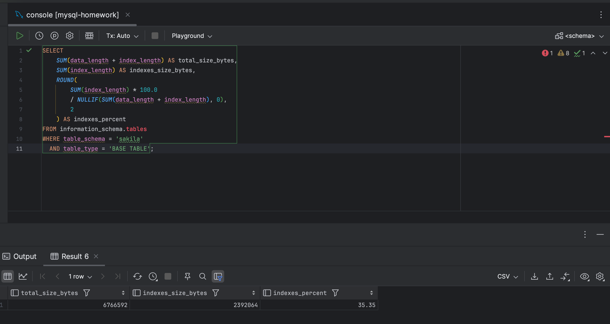
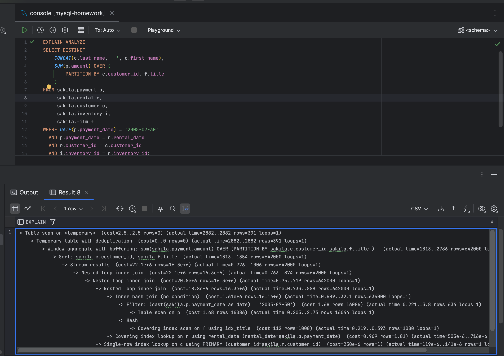
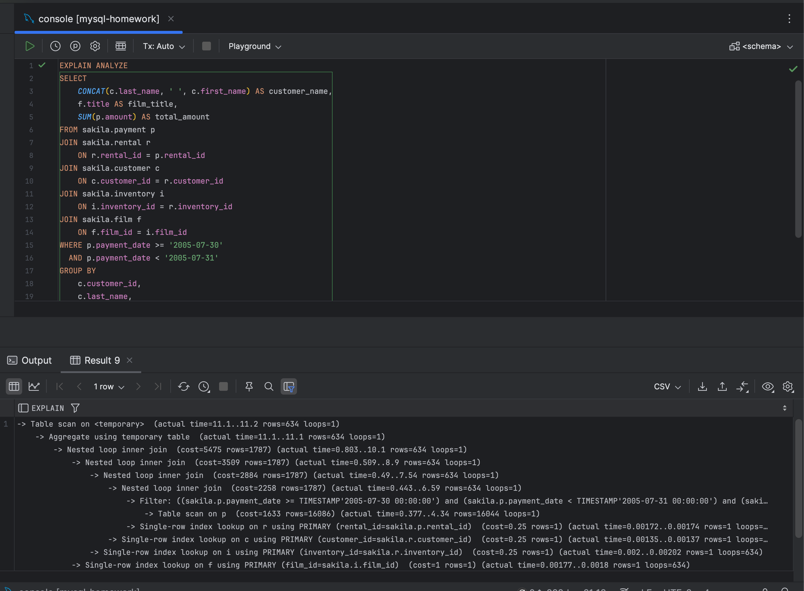

# Домашнее задание к занятию «Индексы» — Сергеев Александр

## Задание 1

Для расчёта использована системная таблица `information_schema.tables`.
Учтены только таблицы учебной базы `sakila`, представления исключены.

```sql
SELECT
    SUM(data_length + index_length) AS total_size_bytes,
    SUM(index_length) AS indexes_size_bytes,
    ROUND(
        SUM(index_length) * 100.0
        / NULLIF(SUM(data_length + index_length), 0),
        2
    ) AS indexes_percent
FROM information_schema.tables
WHERE table_schema = 'sakila'
  AND table_type = 'BASE TABLE';
```

Процент рассчитан по формуле:

Размер индексов / (Размер данных + Размер индексов) × 100%.

`NULLIF()` предотвращает деление на ноль.
Результат округляется до двух знаков после запятой.

Для InnoDB значения приблизительные: `data_length` включает данные
и кластерный индекс, а `index_length` учитывает вторичные индексы.
Таким образом, рассчитывается доля вторичных индексов в общем
учтённом размере таблиц.



## Задание 2

### План выполнения исходного запроса

Для анализа исходного запроса использован `EXPLAIN ANALYZE`.

```sql
EXPLAIN ANALYZE
SELECT DISTINCT
    CONCAT(c.last_name, ' ', c.first_name),
    SUM(p.amount) OVER (
        PARTITION BY c.customer_id, f.title
    )
FROM sakila.payment p,
     sakila.rental r,
     sakila.customer c,
     sakila.inventory i,
     sakila.film f
WHERE DATE(p.payment_date) = '2005-07-30'
  AND p.payment_date = r.rental_date
  AND r.customer_id = c.customer_id
  AND i.inventory_id = r.inventory_id;
```



### Узкие места исходного запроса

1. Таблица `film` не связана с остальными таблицами условием соединения.
   В плане присутствует `Inner hash join (no condition)`.
   Соединение 634 платежей с 1000 фильмами формирует 634 000 строк.

2. Платежи соединяются с арендой по совпадению времени:
   `p.payment_date = r.rental_date`.
   Это не связь по идентификатору аренды. После соединения количество
   промежуточных строк возрастает до 642 000.

3. Оконная функция требует сортировки и буферизации 642 000 строк.
   После этого `DISTINCT` выполняет удаление дубликатов
   с использованием временной таблицы.

4. Условие `DATE(p.payment_date) = '2005-07-30'` применяет функцию
   к колонке и не позволяет использовать обычный индекс по этой колонке
   для поиска диапазона. В плане наблюдается полный просмотр
   таблицы `payment`: 16 044 строки.

Время выполнения исходного запроса по верхнему узлу плана —
около 2882 мс. Получена 391 строка.

### Исправление и оптимизация запроса

Платежи связаны с арендой по `rental_id`, а фильмы —
с экземплярами через `film_id`. Соединения записаны явно через `JOIN`.

Фильтрация по дате заменена на полуоткрытый диапазон без функции
над колонкой. Для получения суммы по покупателю и фильму
используется `GROUP BY` вместо оконной функции и `DISTINCT`.
Название фильма добавлено в вывод для наглядности.

Исправление связей меняет результат исходного запроса:
теперь сумма рассчитывается по фактически арендованным фильмам.

```sql
EXPLAIN ANALYZE
SELECT
    CONCAT(c.last_name, ' ', c.first_name) AS customer_name,
    f.title AS film_title,
    SUM(p.amount) AS total_amount
FROM sakila.payment p
JOIN sakila.rental r
    ON r.rental_id = p.rental_id
JOIN sakila.customer c
    ON c.customer_id = r.customer_id
JOIN sakila.inventory i
    ON i.inventory_id = r.inventory_id
JOIN sakila.film f
    ON f.film_id = i.film_id
WHERE p.payment_date >= '2005-07-30'
  AND p.payment_date < '2005-07-31'
GROUP BY
    c.customer_id,
    c.last_name,
    c.first_name,
    f.title;
```



### Результат исправления запроса

По данным `EXPLAIN ANALYZE`, время выполнения исправленного запроса
составило около 11,2 мс, исходного — около 2882 мс.

Вместо 642 000 промежуточных строк соединения обрабатывают 634 строки.
Для таблиц `rental`, `customer`, `inventory` и `film` используются
точечные обращения по первичным ключам.

Сравнение отражает исправление логики и изменение способа расчёта:
результаты исходного и исправленного запросов различаются.

В плане остался полный просмотр таблицы `payment`:
операция `Table scan on p` читает 16 044 строки.
Следующий шаг — проверка существующих индексов для фильтрации по дате.